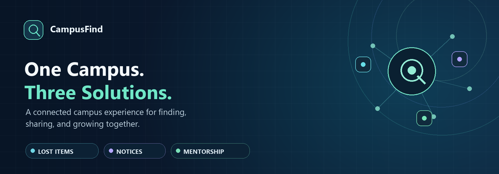
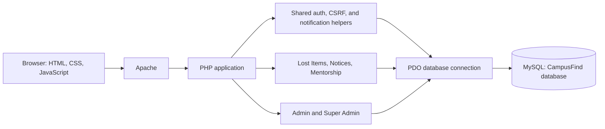

# CampusFind

<p align="center">
  
</p>

<p align="center"><strong>One Campus. Three Solutions.</strong><br>
Lost Items · Notices · Mentorship</p>

<p align="center">
  <a href="https://github.com/Meshcode-003/ISC-Digital-Build-Off-2026-CampuFind"></a>
  
  
  <a href="LICENSE"></a>
</p>

<p align="center">
  <a href="https://skillicons.dev"></a>
</p>

CampusFind brings three useful campus services together behind one account: report and recover lost belongings, keep up with university notices, and connect students with mentors. The project is built for the UEAB ISC Digital Build-Off Hackathon 2026.

> **Implementation note:** This README describes the code currently in this repository. It distinguishes working flows from known gaps; a table or route in the database alone is not treated as proof of a complete user-facing feature.

## Contents

- [Problem](#problem)
- [Solution and features](#solution-and-features)
- [Roles and access](#roles-and-access)
- [Architecture](#architecture)
- [Technology](#technology)
- [Database](#database)
- [Project structure and routes](#project-structure-and-routes)
- [Screenshots](#screenshots)
- [Run locally](#run-locally)
- [Known gaps and next steps](#known-gaps-and-next-steps)
- [Team and repository](#team-and-repository)
- [License](#license)

## Problem

Campus communities rely on timely information and strong peer support, but three everyday challenges can make campus life harder:

1. **Lost belongings:** Students and staff can struggle to report a missing item, find relevant reports, and safely coordinate its return.
2. **Unclear notices:** Important announcements can be scattered across channels, making it difficult to find current information or know who it affects.
3. **Weak mentorship connections:** Students may have difficulty discovering suitable mentors and starting a structured, ongoing connection.

When these processes are fragmented, belongings are harder to recover, people can miss important updates, and opportunities for academic or professional guidance are lost.

## Solution and features

CampusFind provides one PHP application, shared authentication, and a common database for the three modules.

### Lost Items

- Signed-in students and staff can submit a lost-item report, including a photograph captured with their device camera.
- Approved reports can be browsed and searched; new reports are held for administrator review.
- Users can submit claims for eligible reports and track claim decisions.
- Administrators review reports and claims and can record when an item has been returned.

**Current scope:** The user-facing flow is for reporting and claiming lost items. Although the database can represent both `lost` and `found` item types, a complete found-item reporting flow is not currently exposed.

### Notices

- Administrators can create drafts and publish, edit, archive, or pin notices.
- Notices support categories, priority, publication and expiry dates, attachments, and read tracking.
- Audience options include all users, students, or staff; school and department targeting is also available.
- Published notices are listed for signed-in users and can be opened individually.

### Mentorship

- Students and staff can browse active mentors and search by name or expertise.
- Prospective mentors can apply with a profile and expertise; an administrator reviews the application.
- Students can request mentorship. Mentors can accept or decline; students can cancel pending requests, and participants can complete an accepted connection.
- Accepted connections support participant-only conversations and session scheduling.
- Mentor profiles include availability and optional WhatsApp contact preferences.

### Shared accounts and notifications

- Registration is available for student and staff accounts. Passwords are hashed, and the application uses session-based authentication and CSRF tokens for state-changing forms.
- The roles are `student`, `staff`, `admin`, and `super_admin`.
- One notification system serves the modules, with a notification bell, unread counts, a notifications page, and links to relevant application pages.
- Notifications are used for events such as notice publication, lost-item review, mentorship requests and messages, and new registrations. Unread conversation notifications are reused instead of creating one for every message.
- Superadmins manage administrator accounts and assignments, account roles/status, and system-level activity.

## Roles and access

| Role | Current responsibilities |
|---|---|
| Student / Staff | Use Lost Items, Notices, and Mentorship; manage their own reports, claims, requests, messages, and sessions where applicable. |
| Admin | Review module activity, including lost-item reports and claims, mentor applications, and notices. |
| Super Admin | Manage accounts and administrator assignments, review system-level activity, and access administrative workflows. |

Module assignments are stored for administrators. **Authorization is not yet uniform across every module:** Notices administrator routes check the Notices assignment, while Lost & Found and Mentorship administrator routes currently use the general admin/superadmin role check. Do not treat stored assignments as a restriction on those latter routes.

## Architecture

The application uses server-rendered PHP pages, shared authentication/CSRF/notification helpers, and a PDO connection to MySQL. The browser also runs the small amount of JavaScript used for interactions such as camera capture and refreshing mentorship messages.



## Technology

| Area | Technology |
|---|---|
| Server-side application | PHP 8.1 or later |
| Database access | PDO with the MySQL driver |
| Database | MySQL-compatible SQL; InnoDB tables and foreign keys |
| User interface | HTML, CSS, and browser JavaScript |
| Local development | Apache and MySQL, commonly provided by XAMPP |

No Composer or npm dependency manifest is present; there are no Composer or npm install steps. The repository does not pin a MySQL/MariaDB release. PHP 8.2.12 was available in the inspection environment.

## Database

[`database/campusfind.sql`](database/campusfind.sql) creates the `campusfind` database and the foundational tables, including `users`, `roles`, `items`, `item_images`, `claims`, `notification`, and `activity`.

Apply the additive migrations in numerical order:

1. [`001_add_notices_and_mentorship.sql`](database/migrations/001_add_notices_and_mentorship.sql) — Notices and core mentorship tables.
2. [`002_mentorship_workflows.sql`](database/migrations/002_mentorship_workflows.sql) — Mentor applications, conversations, messages, and sessions.
3. [`003_module_admin_assignments.sql`](database/migrations/003_module_admin_assignments.sql) — Administrator-to-module assignment records.
4. [`004_add_notice_targeting_and_user_affiliations.sql`](database/migrations/004_add_notice_targeting_and_user_affiliations.sql) — Notice targeting and user affiliations.
5. [`005_enhance_notices.sql`](database/migrations/005_enhance_notices.sql) — Structured notice details and pinning.
6. [`006_seed_notice_categories.sql`](database/migrations/006_seed_notice_categories.sql) — Initial notice categories.
7. [`007_centralized_notifications.sql`](database/migrations/007_centralized_notifications.sql) — Notification destinations/deduplication and mentorship conversation presence.

Migration 007 updates the existing singular `notification` table; it does not introduce a separate notification store. Apply it before running the current notification-enabled code against a database created from an earlier schema. Back up existing data before applying migrations.

## Project structure and routes

| Path | Purpose |
|---|---|
| [`config/`](config/) | Environment loading, application paths, sessions, and PDO setup. |
| [`includes/`](includes/) | Shared authentication, CSRF, Notices, and notification helpers. |
| [`public/`](public/) | Registration, login, dashboard, administrator module selection, and notifications. |
| [`lostandfound/`](lostandfound/) | Lost-item reports, browsing, claims, and review workflows. |
| [`notices/`](notices/) | Notice feed, detail pages, and notice administration. |
| [`mentorship/`](mentorship/) | Mentor discovery, applications, requests, conversations, and sessions. |
| [`admin/`](admin/) | Legacy/standalone announcement route; active Notices administration is under `notices/admin/`. |
| [`superadmin/`](superadmin/) | Superadmin dashboard and administrator provisioning. |
| [`database/`](database/) | Foundational schema, ordered migrations, and the CLI Super Admin bootstrap. |
| [`docs/`](docs/) | Project banner and reserved screenshot directories. |

The root [`index.php`](index.php) redirects to the login page when no `index.html` exists. The repository does not currently contain a standalone public marketing landing page.

| Page | Local path |
|---|---|
| Register / sign in | `/campusfind/public/register.php` · `/campusfind/public/login.php` |
| Signed-in dashboard | `/campusfind/public/dashboard.php` |
| Notifications | `/campusfind/public/notifications.php` |
| Lost Items | `/campusfind/lostandfound/` |
| Notices | `/campusfind/notices/` |
| Mentorship | `/campusfind/mentorship/` |
| Super Admin | `/campusfind/superadmin/` |

## Screenshots

There are **no application screenshots in the repository**. The images under `lostandfound/uploads/items/` are user-uploaded item photos, not product screenshots, and are intentionally not presented as UI captures. No screenshots are embedded below.

Capture genuine screenshots from a running local application and place them in the matching directory:

| Capture | Directory | Notes |
|---|---|---|
| Landing page / entry point | [`docs/screenshots/landing-page/`](docs/screenshots/landing-page/) | There is no standalone public landing page today; the root redirects to sign-in. |
| Authentication | [`docs/screenshots/authentication/`](docs/screenshots/authentication/) | Registration and sign-in. |
| Lost Items | [`docs/screenshots/lost-items/`](docs/screenshots/lost-items/) | Report form, report feed, claims, or review flow. |
| Notices | [`docs/screenshots/notices/`](docs/screenshots/notices/) | Notice feed, detail, and administration. |
| Mentorship | [`docs/screenshots/mentorship/`](docs/screenshots/mentorship/) | Mentor discovery, request, conversation, or sessions. |
| Admin | [`docs/screenshots/admin/`](docs/screenshots/admin/) | Relevant module review page. |
| Super Admin | [`docs/screenshots/superadmin/`](docs/screenshots/superadmin/) | System-level account or assignment management. |

## Run locally

### Prerequisites

- Windows with [XAMPP](https://www.apachefriends.org/) or another local Apache/PHP/MySQL setup.
- PHP 8.1 or later, with `pdo_mysql`, `mbstring`, and `fileinfo` enabled.
- MySQL or compatible MariaDB with InnoDB and foreign-key support.
- A browser. Camera capture requires browser permission and a secure context; `localhost` is supported for local development.

### Install

1. Clone the repository into the directory matching the configured URL path:

   ```powershell
   git clone https://github.com/Meshcode-003/ISC-Digital-Build-Off-2026-CampuFind C:\xampp\htdocs\campusfind
   ```

2. Start Apache and MySQL from the XAMPP Control Panel.

3. Open `http://localhost/phpmyadmin`, select the MySQL server, and import [`database/campusfind.sql`](database/campusfind.sql). The script creates the `campusfind` database and foundational schema.

4. Select the `campusfind` database and import migrations `001` through `007` from [`database/migrations/`](database/migrations/) **in numerical order**. For an existing installation, back up the database and apply only migrations that have not already run.

5. Create the local environment file and configure the database connection:

   ```powershell
   Set-Location C:\xampp\htdocs\campusfind
   Copy-Item .env.example .env
   notepad .env
   ```

   Set `DB_HOST`, `DB_PORT`, `DB_DATABASE`, `DB_USERNAME`, and `DB_PASSWORD` to match MySQL. The example uses `127.0.0.1`, port `3306`, database `campusfind`, and the local XAMPP-style `root` account with a blank password. Change these values if your local MySQL setup differs. The `.env` file is local configuration and must not be committed.

6. Create the initial Super Admin once. Choose a password of at least 12 characters; the bootstrap script reads it from a process environment variable and is CLI-only:

   ```powershell
   $secret = Read-Host "Initial Super Admin password" -AsSecureString
   $env:CAMPUSFIND_SUPERADMIN_PASSWORD = [System.Net.NetworkCredential]::new("", $secret).Password
   & C:\xampp\php\php.exe C:\xampp\htdocs\campusfind\database\create_superadmin.php
   Remove-Item Env:CAMPUSFIND_SUPERADMIN_PASSWORD
   ```

   Enter the account details when prompted, then sign in at `http://localhost/campusfind/public/login.php`. The bootstrap script refuses to create another Super Admin if one already exists.

7. Open `http://localhost/campusfind/`; with no root `index.html`, it redirects to the sign-in page. Register a student or staff account at `http://localhost/campusfind/public/register.php`, or sign in with the Super Admin account created above.

There are no Composer or npm packages to install. If the project directory is not `C:\xampp\htdocs\campusfind`, update the hard-coded `APP_BASE_PATH` in [`config/config.php`](config/config.php) and keep it consistent with the URL used in the browser.

### Troubleshooting

- **Database connection error:** Confirm MySQL is running and `.env` values match the database name, host, port, username, and password.
- **Missing tables or columns:** Confirm the base schema was imported first, followed by every required migration in order. Do not reapply migrations to an already migrated database.
- **`Unknown column 'notification_url'`:** Apply [`007_centralized_notifications.sql`](database/migrations/007_centralized_notifications.sql) once to the configured `campusfind` database. It adds the notification destination and deduplication fields while preserving existing notifications.
- **Page links point to the wrong path:** The app expects `/campusfind`; update `APP_BASE_PATH` if the installation URL differs.
- **Camera does not open:** Allow camera access in the browser and use `localhost` or HTTPS.
- **Item photo cannot be saved:** Ensure Apache can write to `lostandfound/uploads/items/`.
- **Super Admin bootstrap fails:** Confirm migrations and the database configuration are complete, and check that `CAMPUSFIND_SUPERADMIN_PASSWORD` is set in the same PowerShell session. The password must be at least 12 characters; bootstrap can only run once.

## Known gaps and next steps

The following are improvements, not claims about current functionality:

- Add a complete user-facing found-item submission and recovery flow.
- Apply module-assignment authorization consistently to Lost & Found and Mentorship administrator routes.
- Add a public, unauthenticated landing page.
- Capture and review real screenshots for the documentation.
- Add repeatable automated integration tests for the database-backed workflows.

## Team and repository

| Name | Role |
|---|---|
| Meshack Oduor | Team Leader |
| Tumaini Kiplimo | Team Member |


**Repository:** [Meshcode-003/ISC-Digital-Build-Off-2026-CampuFind](https://github.com/Meshcode-003/ISC-Digital-Build-Off-2026-CampuFind)

Public commit metadata includes the GitHub accounts [tumainihope00-creator](https://github.com/tumainihope00-creator), [Alphy-Byte](https://github.com/Alphy-Byte), and [Meshcode-003](https://github.com/Meshcode-003). The available commit attribution does not reliably map these accounts to the team roles above.

## License

CampusFind is distributed under the [MIT License](LICENSE).
